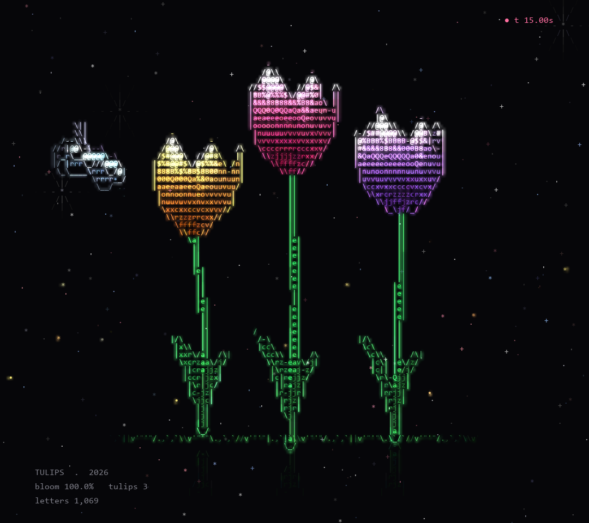

# TULIPS

Three tulips (sunny yellow, soft pink and lavender) grow one after another behind a
travelling point of light. Long leaves rise around each stem, the buds appear and slowly
open in the sun, and the flowers sway in the breeze. A little blue butterfly flutters
between them while pollen drifts and the grass waves.



## How to run

```bash
pip install numpy pygame-ce
python tulip.py
```

Save one frame without opening a window (here at t = 15 s):

```bash
python tulip.py --shot 15 tulips.png
```

| Key | Action |
|---|---|
| `SPACE` | Pause / resume |
| `R` | Restart |
| `S` | Save a screenshot |
| `ESC` | Quit |

Needs `../ascii_engine.py` (keep it in the main folder).

## What happens

| Time | Moment |
|---|---|
| 0 - 4 s | The three stems grow one after another, and the leaves unfurl |
| 2 - 5 s | The buds appear on top of each stem |
| 5 - 10 s | The tulips open, then gently "breathe" |
| 7 s + | The butterfly arrives and flutters around the flowers |

## Customise

Edit the `TULIPS` list at the top of `tulip.py`. Each tulip has:

- `x`, `z`: position
- `top`: how tall it grows
- `col`: (tip colour, base colour), for example `((255, 120, 120), (200, 0, 40))` for a red tulip
- `t0`: when it starts growing
- `lean`: how much the stem leans

Add a fourth entry to the list to plant another tulip.

## How it works

- Each flower has six cupped petals (three outer, three inner) built as curved surfaces
  around the stem. Opening them pushes the tips outward.
- The wind bends each plant more toward the top, so the flower trails behind the stem.
- The butterfly has two flapping wing surfaces that follow a looping path and face the
  way it flies.
- Rendering (lighting, z-buffer, character shading, outlines, glow) comes from `ascii_engine.py`.

---

Made with ♥ by **Aavi** · [GitHub @awnish9002](https://github.com/awnish9002) ·
[Instagram @code_with_aavi](https://www.instagram.com/code_with_aavi/) ·
[All pieces](../README.md)
